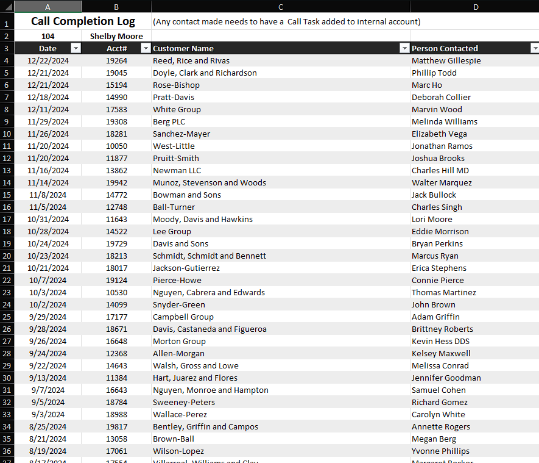
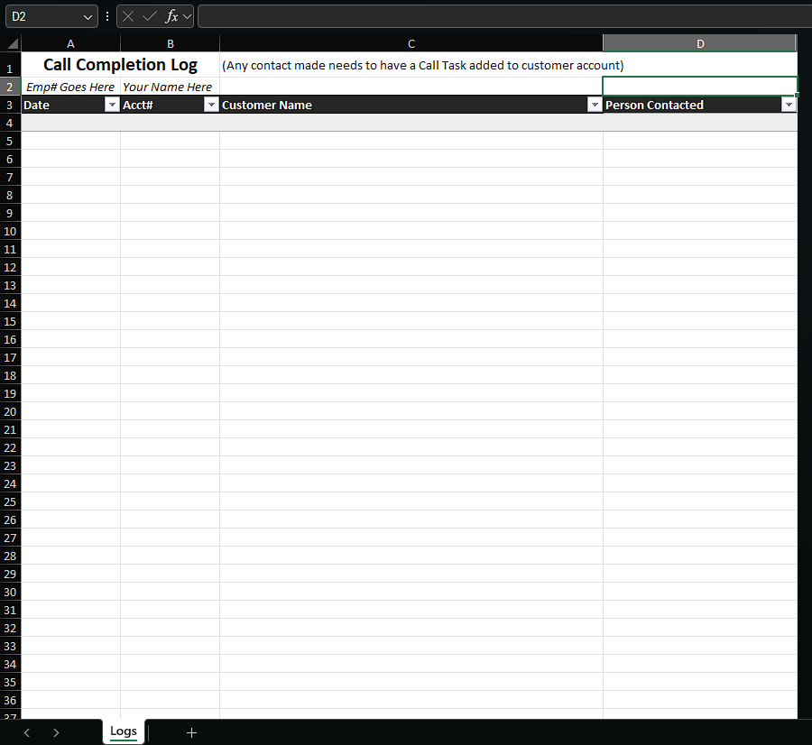
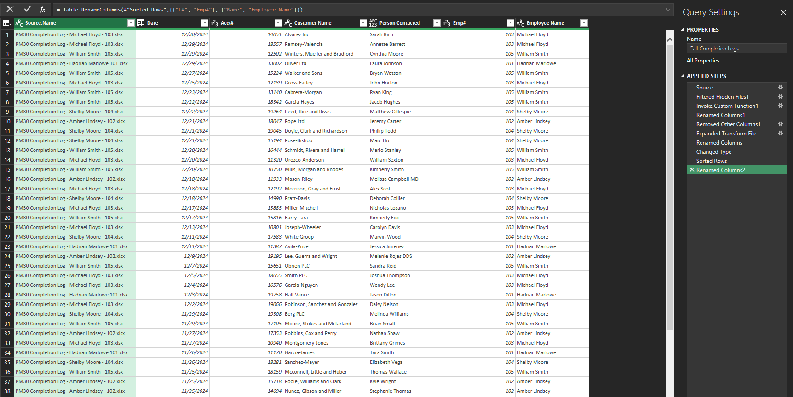
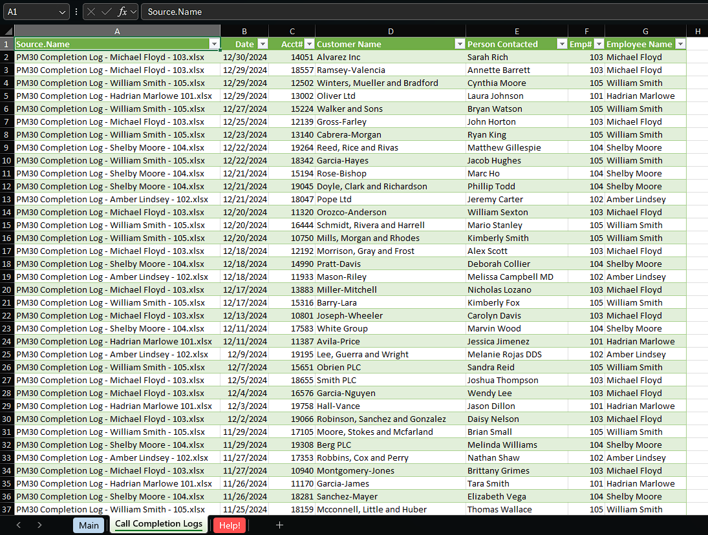
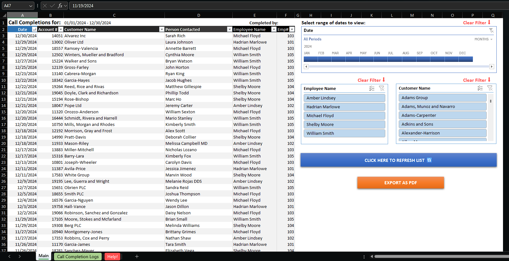
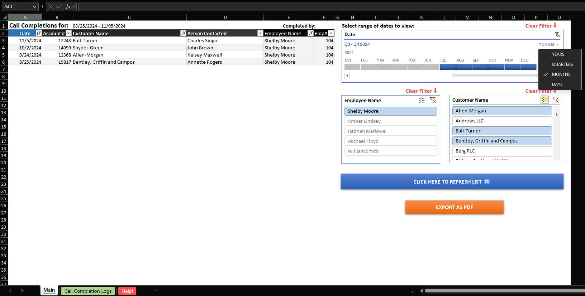
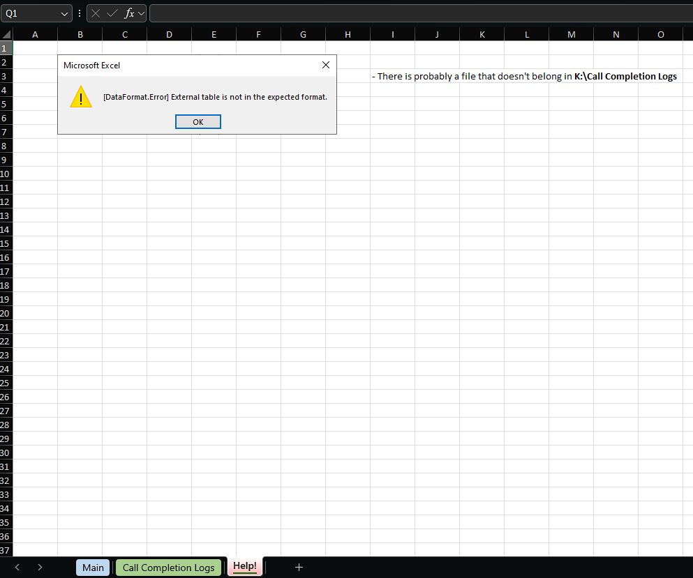

## Problem

After every purchase, someone on the sales team called the customer. Each rep logged those calls their own way, in their own file. Nobody could see team-wide follow-up activity, reports came in different formats, and filtering recent outreach meant copying data by hand.

The goal: make daily logging fast for the reps, and give the department head one up-to-date view of the whole team.

## Approach

### A log sheet anyone can fill in

Each rep logs calls in the same simplified sheet: date, account, customer, who they spoke with. Fewer columns meant fewer ways to get it wrong.



### A template that protects the format

Every log is created from an Excel template (`.xltx`), so the column structure, permissions and save location are identical for every rep, and nobody can accidentally edit the master layout.



### Power Query does the combining

All logs live in one shared folder. Power Query reads every file in it, cleans and types the columns, and appends them into a single table. A new rep's file is picked up automatically, with no setup.





### A dashboard for the department head

The combined table feeds a dashboard with slicers for employee, customer and date range, plus two buttons: refresh everything, and export the current view as a dated PDF.





The header always states the date range currently in view, so a printed or exported report can't be misread:

```text
=IF(A3<>"",
    TEXT(MIN($A$2:$A1000), "mm/dd/yyyy") & " - " & TEXT(MAX($A$2:$A1000), "mm/dd/yyyy"),
    "There is no data for this date range.")
```

The export button names the file for the day it was run, so reports file themselves:

```vb
Sub SaveAsPDFWithDate()
    Dim filePath As Variant
    filePath = Application.GetSaveAsFilename( _
        InitialFileName:="Call Completion List - " & Format(Date, "mm.dd.yyyy") & ".pdf", _
        FileFilter:="PDF Files (*.pdf), *.pdf", _
        Title:="Save As PDF")

    If filePath <> False Then
        ActiveSheet.ExportAsFixedFormat Type:=xlTypePDF, Filename:=filePath
    End If
End Sub
```

### A help sheet for when things go wrong

A built-in help tab lists the errors a rep is most likely to hit and how to fix each one, so the tool doesn't depend on me being around.



## Result

- Reps spent less time on documentation and more on customers.
- Standardized logs removed the inconsistencies and misreporting between reps.
- The department head got instant visibility into team activity, without chasing anyone for reports.

## What I learned

The hard part wasn't the VBA or the queries. It was keeping the front end simple enough for non-technical users while the automation underneath did the real work. Getting there meant sitting with the people who'd use it and turning what they needed into something that saved them time.

<small>All data shown was generated with the Python Faker package. No real customer or employee data is included.</small>
