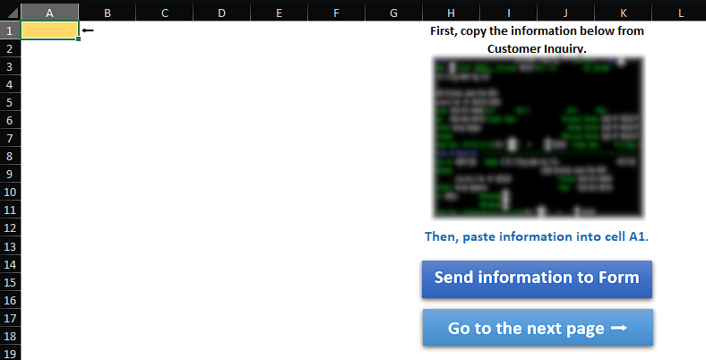
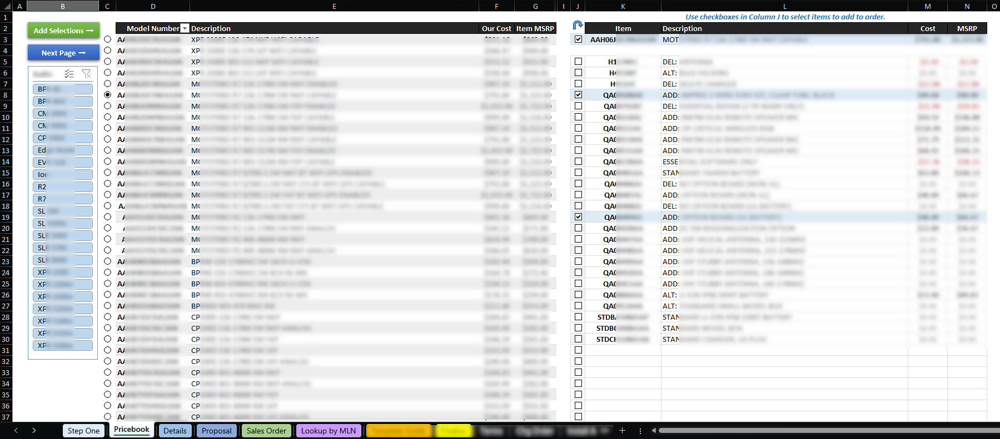
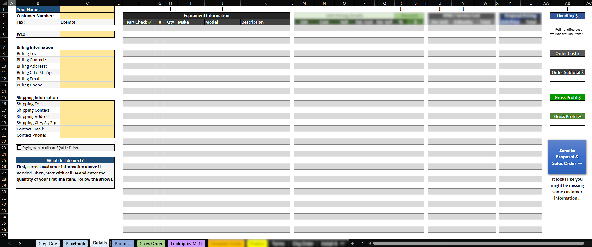
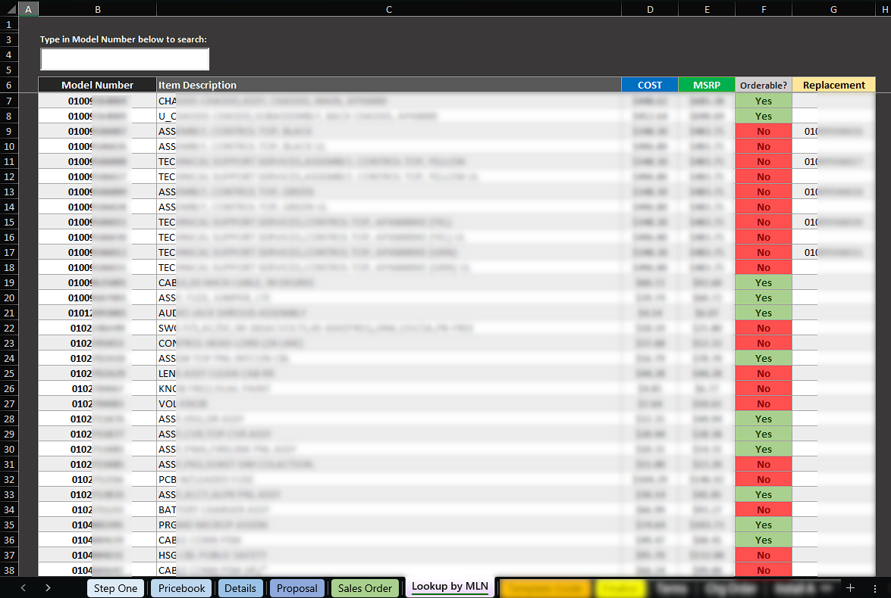

## Problem

The sales form was slow, error-prone and hard for non-technical reps to use. Complex model numbers were typed by hand, so typos were common. There was no easy way to check that an add-on was compatible with a model or that the price was right. Finishing a proposal meant copying the same details across several sheets.

## Approach

The rebuilt form walks a rep through four steps. Helper cells change their message at each step to say exactly what to do next, so the form explains itself.

### 1. Paste the customer record

The rep pastes the raw, terminal-style customer record from the company system into one cell. A macro splits it into fields and fills in the form.



```vb
Sub CustomerCleanup()
    Selection.TextToColumns Destination:=Range("A21"), DataType:=xlDelimited, _
        ConsecutiveDelimiter:=True, Space:=True
End Sub
```

The helper cell next to it tracks progress:

```text
=IF(A1<>"",
    IF(Details!$C$2<>"",
        "Success! Click the 'Go to the next page' button below to proceed.",
        "Great! Now click the 'Send information to Form' button below."),
    "Then, paste information into cell A1.")
```

### 2. Pick a model, get only compatible add-ons

Choosing a model number filters the price book down to the add-ons that fit it. The rep ticks what they need and sends the selection to the order in one click.



The original filter was a legacy array formula (sheet path simplified; the real one is redacted):

```text
=IFERROR(INDEX(PriceBook!$B$2:$B$10000,
    SMALL(IF(PriceBook!$A$2:$A$10000=$K$3,
        ROW(PriceBook!$A$2:$A$10000)-ROW(PriceBook!$A$2)+1), ROW(1:1))), "")
```

In current Excel the same job is a single dynamic array, which spills on its own and needs no fill-down:

```text
=FILTER(PriceBook!$B$2:$B$10000, PriceBook!$A$2:$A$10000=$K$3, "")
```

### 3. Finalize quantities, discounts and fees

The details sheet checks each line as it's entered: whether the model number exists, whether make and model agree, and how handling and card fees roll into the price. Gross profit updates live. When everything checks out, one macro pastes the values into the Proposal and Sales Order sheets and hides unused rows, so the output is clean.



```text
=IF(J4<>"", IF(AND(J4<>"", I4<>""), "Valid MLN", "MLN not found."), "")
```

### 4. Bonus: model number search

A search tab looks up partial model numbers and, when a product has been discontinued, points to its current replacement.



## Result

- Proposals take at least 50% less time to create.
- Far fewer manual-entry errors, with validation across models, add-ons and pricing.
- Reps spend their time on sales conversations, not on spreadsheet logistics.

## What I learned

Designing for non-technical users matters as much as the logic underneath. Small touches like helper cells and plain-language error prompts cut support requests more than any amount of clever formula work. Time spent up front on solid scripting paid for itself in ease of use.

<small>The form is tied to live product databases and catalogs that couldn't be anonymized, so pricing and product details in the screenshots are blurred.</small>
